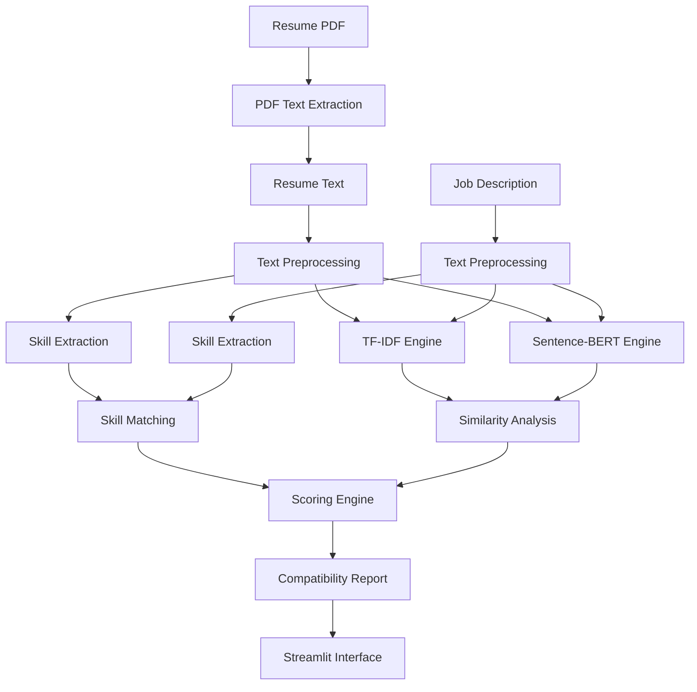

# AI-Powered Resume Intelligence & Job Matching System

> An explainable, NLP-based system that evaluates how well a candidate's resume aligns with a given job description.

## Overview

Recruiters often receive hundreds of resumes for a single job opening. Manually comparing every resume against the job requirements is time-consuming, inconsistent, and difficult to scale.

The **AI-Powered Resume Intelligence & Job Matching System** aims to automate this process using Natural Language Processing (NLP) and machine learning techniques.

The system takes a candidate's resume in PDF format and a job description as input. It analyzes both documents, identifies relevant skills, measures semantic similarity, and generates an explainable compatibility score.

Unlike a simple keyword-matching tool, this project combines explicit skill matching with contextual semantic similarity to provide a more meaningful assessment of candidate-job compatibility.

## Problem Statement

Traditional resume screening systems often rely heavily on exact keyword matching.

For example, a job description may mention:

- Machine Learning
- Natural Language Processing
- Python
- Deep Learning

A candidate may describe relevant experience using different words or sentence structures. A keyword-only system may fail to recognize this relationship.

This project addresses the problem by combining:

1. **Skill-based matching** to identify explicitly relevant technical skills.
2. **TF-IDF similarity** to establish a traditional lexical similarity baseline.
3. **Sentence-BERT similarity** to capture contextual relationships between resume content and job requirements.
4. **An explainable scoring mechanism** to highlight strengths and missing skills.

## Objectives

- Extract meaningful text from resume PDFs.
- Process resume and job description text using NLP techniques.
- Identify technical skills using a predefined skills dictionary.
- Calculate lexical similarity using TF-IDF and cosine similarity.
- Calculate contextual similarity using Sentence-BERT.
- Generate a combined resume-job compatibility score.
- Identify missing skills and relevant matching skills.
- Present the analysis through an interactive web interface.
- Evaluate the system using sample resumes and job descriptions.

## System Architecture

The system follows a modular pipeline.



## Methodology

### 1. Resume Text Extraction

The resume is provided as a PDF document.

The system extracts textual content from the PDF using **PyMuPDF**.

The extracted text is then prepared for further processing.

### 2. Text Preprocessing

The extracted resume text and job description are processed to improve consistency.

The preprocessing stage may include:

- Text normalization
- Whitespace handling
- Cleaning unnecessary characters
- Preparing text for skill extraction and similarity analysis

### 3. Skill Extraction and Matching

A predefined technical skills dictionary is used to identify relevant skills in both documents.

The system compares the skills found in the resume with those required by the job description.

The skill matching process identifies:

- Matching skills
- Missing skills
- Overall skill coverage

The skill compatibility score is calculated as:

\[
\text{Skill Score} =
\frac{\text{Matched Unique JD Skills}}
{\text{Total Unique JD Skills}}
\times 100
\]

This score represents the percentage of unique job-description skills identified in the resume.

### 4. TF-IDF Similarity

TF-IDF (Term Frequency–Inverse Document Frequency) is used to represent text based on the importance of its words.

The resulting vectors are compared using cosine similarity.

This component acts as a traditional lexical similarity baseline.

### 5. Contextual Semantic Similarity

The system uses the Sentence-BERT model:

`all-MiniLM-L6-v2`

Sentence-BERT generates dense vector representations of text.

These representations are compared using cosine similarity to estimate the contextual relationship between the resume and the job description.

The semantic score is calculated as:

\[
\text{Semantic Score} =
\text{SBERT Cosine Similarity}
\times 100
\]

The semantic similarity score is intended to complement explicit skill matching rather than replace it.

### 6. Final Compatibility Score

The final score combines skill coverage and semantic similarity.

\[
\text{Final Score} =
0.5 \times \text{Skill Score}
+
0.5 \times \text{Semantic Score}
\]

The two components contribute equally to the initial scoring model.

The TF-IDF score is retained separately as a baseline for comparison and is not included in the initial final-score formula.

The scoring model may be refined after evaluation.

## Technology Stack

| Component | Technology |
|---|---|
| Programming Language | Python |
| Web Interface | Streamlit |
| PDF Text Extraction | PyMuPDF |
| NLP Processing | spaCy |
| Skill Matching | Dictionary-based matching and PhraseMatcher |
| Lexical Similarity | TF-IDF |
| Semantic Similarity | Sentence-BERT |
| Machine Learning Utilities | scikit-learn |
| Data Handling | Pandas |
| Evaluation | Python, scikit-learn, and CSV-based results |

## Project Structure

```text
resume-intelligence/
│
├── app.py
│
├── pdf_reader.py
├── skill_matcher.py
├── tfidf_engine.py
├── sbert_engine.py
├── scorer.py
│
├── data/
│   ├── skills.csv
│   └── sample_resumes/
│
├── evaluation/
│   ├── evaluate.py
│   └── results.csv
│
├── tests/
│   ├── test_pdf_reader.py
│   ├── test_skill_matcher.py
│   ├── test_tfidf.py
│   └── test_sbert.py
│
├── requirements.txt
├── .gitignore
└── README.md
```

## Evaluation Plan

The system will be evaluated using sample resumes and job descriptions.

The evaluation will focus on:

- Correctness of PDF text extraction
- Accuracy of skill identification
- Identification of missing skills
- TF-IDF similarity scores
- Sentence-BERT similarity scores
- Final compatibility scores
- Runtime and computational efficiency
- Consistency of results across different resumes

The TF-IDF and Sentence-BERT approaches will be compared to understand the differences between lexical and contextual similarity.

The evaluation will also examine whether the final score provides useful and interpretable information about candidate-job alignment.

## Expected Output

For a given resume and job description, the system is designed to produce:

- Resume text extracted from the PDF
- Skills identified in the resume
- Skills required by the job description
- Matching skills
- Missing skills
- TF-IDF similarity score
- Semantic similarity score
- Final compatibility score
- An interpretable summary of the matching results

## Limitations

- Skill extraction depends on the coverage and quality of the predefined skills dictionary.
- Resume formatting may affect PDF text extraction.
- Semantic similarity does not guarantee that a candidate possesses a particular skill.
- The compatibility score is an estimate of textual alignment, not a definitive measure of candidate ability.
- The initial scoring weights are heuristic and require evaluation.
- The system is intended as a decision-support tool, not an automated hiring authority.

## Development Roadmap

| Phase | Task | Status |
|---|---|---|
| Phase 0 | Project setup and environment configuration | Completed |
| Phase 1 | Resume PDF text extraction | Planned |
| Phase 2 | Skill extraction and matching | Planned |
| Phase 3 | TF-IDF similarity engine | Planned |
| Phase 4 | Sentence-BERT semantic engine | Planned |
| Phase 5 | Compatibility scoring and reporting | Planned |
| Phase 6 | Streamlit application | Planned |
| Phase 7 | Evaluation and documentation | Planned |

## Installation

Clone the repository:

```bash
git clone https://github.com/Srixvas/Resume-Checker.git
cd Resume-Checker
```

Create and activate a virtual environment:

```bash
python -m venv .venv
```

On Windows Git Bash:

```bash
source .venv/Scripts/activate
```

Install the required dependencies:

```bash
python -m pip install -r requirements.txt
```

## Running the Application

Once the implementation is complete, launch the application using:

```bash
python -m streamlit run app.py
```

## Academic Project

This project is being developed as an academic NLP and machine learning project.

The objective is to understand and implement the underlying algorithms, evaluate their behavior, and build a practical resume-job matching application without relying on external generative AI APIs.

---

**Built with Python, NLP, and Machine Learning.**